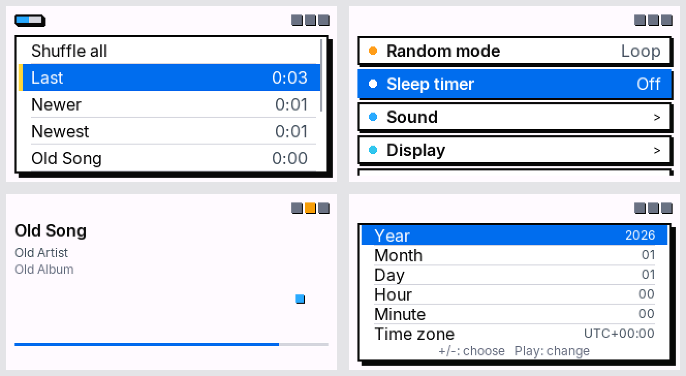
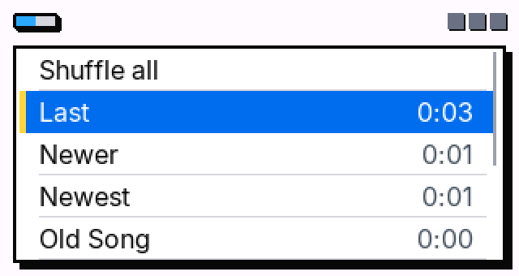
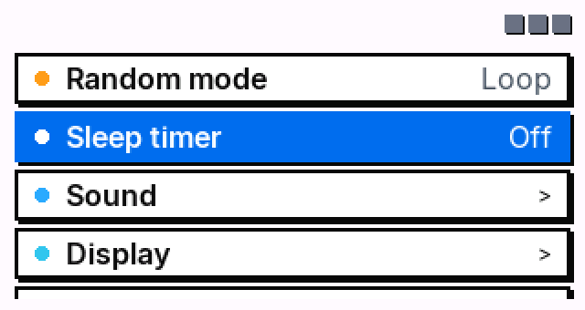
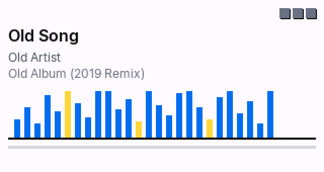
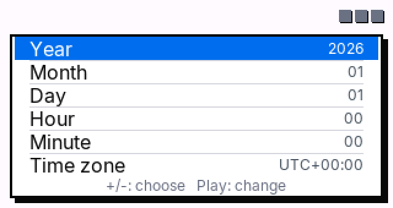
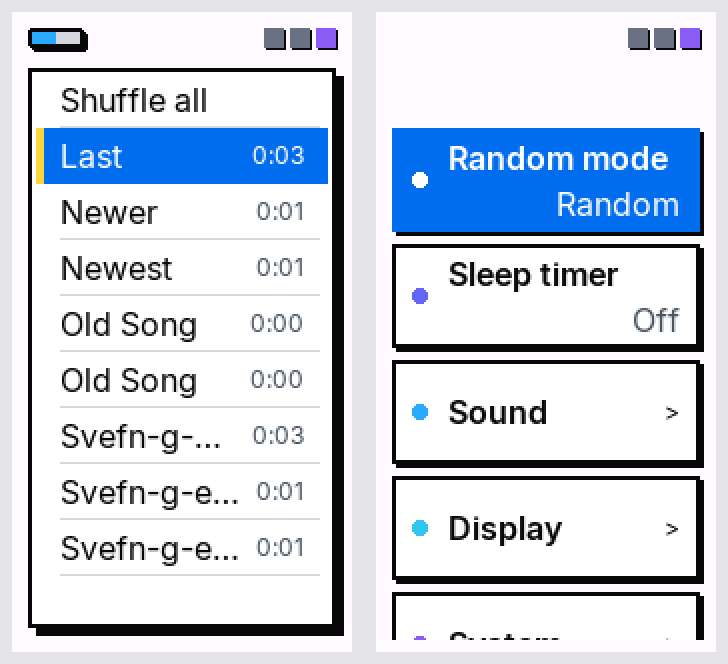
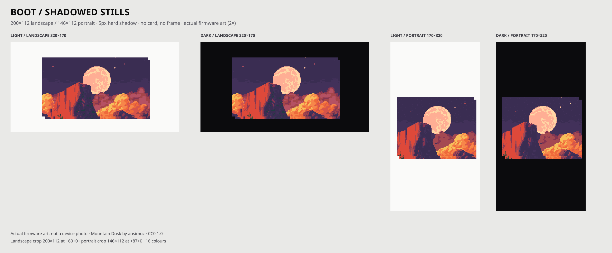

# EchoNeubrutalism

**EchoPod-based firmware for the 512 MB Snowsky (FiiO) Echo Mini, with a personal neo-brutalist Lite UI.**

[中文说明](README.zh-CN.md) · [Docs](docs/README.md) · [AI disclosure](AI_DISCLOSURE.md)

> **Personal fork.** Not the official EchoPod project, and not affiliated with FiiO or Snowsky.
> Tested only on the **512 MB** Echo Mini. The **8 GB** model is not supported.

<p align="center">
  
</p>

<p align="center"><em>Current Lite UI at 2×: All Songs, Settings, Now Playing and Date/Time. Simulator screenshots; the key map and caveats are in <a href="docs/lite/README.md">docs/lite/README.md</a>.</em></p>

## What this is

This is my personal build of [EchoPod](https://github.com/BasilSkyWalk/echopod) for the
**512 MB** Echo Mini. It keeps EchoPod's playback engine and fixes, and replaces the interface
with a compact Lite UI for 320×170 and 170×320.

This branch now also carries the upstream **EchoPod 0.14.0** 512 MB support and fixes, including
its eMMC/SD-NAND start-up, updater and power-off changes. See
[docs/release-notes.md](docs/release-notes.md), [docs/known-issues.md](docs/known-issues.md)
and [docs/user-guide.md](docs/user-guide.md) for the upstream documentation; the Lite-specific
guide is [docs/lite/README.md](docs/lite/README.md).

It is **not** a stock replacement for the 8 GB player. Do not flash these images on an 8 GB unit.

**Start here:** [Lite guide and key map](docs/lite/README.md) ·
[Full controls](docs/lite/shortcuts.md) ·
[Install and recovery](docs/lite/install-512m.md).

> **Personal build.** Not the official EchoPod project, and not affiliated with FiiO or Snowsky.
> Flashing custom firmware can brick the device or erase data. Keep the official firmware and a
> known recovery path. Tested on one 512 MB unit; the 8 GB model is not supported.

## Tested hardware

| | |
|---|---|
| Device | Snowsky (FiiO) Echo Mini **512 MB** |
| Hardware | 2.2.0 |
| Storage | SD NAND, internal FAT32 user volume |
| Tested | Earlier Lite builds on one 512 MB unit, 2026 |
| Not tested | 8 GB Echo Mini, other hardware revisions |

The newest dark/portrait build still needs a final device check. The stock FiiO updater and the
MaskROM recovery path were both exercised during development.

## Interaction and keys

There is **no Home screen**. The roots are **All Songs** and **Favorites**.

| Key | Behaviour |
|---|---|
| Short Back | Root: switch All Songs / Favorites. List: up one level. Settings: back one page, or leave to the current root. |
| Long Back | Open Settings from a normal screen; inside Settings, return to the current root. |
| Short Menu | Open Now Playing; from Now Playing, open Up Next. |
| Long Menu | The screen's function key: A-Z in All Songs/Favorites, next row in A-Z, current-song actions in Now Playing. No action in Up Next/Settings. |
| Play | Open/choose a row; in Settings change a value or open a category; in Date/Time start/stop editing. |
| Volume | Move the selection; in Now Playing short = volume, double = previous/next, long = seek. |

Long Back is the single Settings entry. There is no double Menu and no standalone playback panel.
Full key table and A-Z geometry: [docs/lite/shortcuts.md](docs/lite/shortcuts.md).

## What I changed

- **Roots:** All Songs and Favorites; Home removed. Short Back switches them, Short Menu opens
  Now Playing, Long Back opens Settings.
- **Status row:** 10×10 blocks at y=8; Bluetooth, playback and an always-visible mode block
  (purple random, gray loop, gray `1` loop-one). Inactive states are neutral gray; root lists add
  the segmented All Songs/Favorites meter on the left.
- **Settings:** five compact rows with distinct orange/indigo/blue/cyan/purple dots and
  right-aligned values; four rows visible with the next peeking. Random/Sleep are direct;
  Sound/Display/System open category pages. Date/Time uses the same card.
- **Favorites:** path-hashed song list (up to 512), title + duration, A-Z jump, its own explicit
  queue and resume, Add/Remove in the song actions.
- **Now Playing:** no time row, progress thumb or separate mode icon; when a track has no synced
  lyrics, a small ball bounces in the lyric area and changes colour at each edge, with a flat
  progress bar that doubles as the temporary volume meter, 85 one-decibel volume steps, and the
  same top status row as every screen.
- **Sorting:** GB2312 Chinese by pinyin and kana by romaji, interleaved with Latin under A-Z.
  Leading articles are literal: "The End of the World" sorts under T, not E.
- **Review fixes:** category selection is remembered; Date/Time keeps unsaved edits across the
  Now Playing overlay; 90/120-minute sleep countdown is formatted correctly; dark-mode list
  separators use the theme divider; portrait All Songs shows nine rows; Settings list subpages
  start below the status row.
- **Space work:** Lite icon masks moved to a glyph face; Lite theme-store/assets removed; unused
  paths dropped. Resident tables are close to full, so keep new table data small.
- **Upstream:** current with EchoPod 0.14.0 when this README was written, including its playback,
  USB, FAT and HE-AAC fixes.

The boot chain, IDB, PMU firmware, fw2 and slot layout are not modified.

## UI previews

> These are current simulator screenshots at 2×, not device photos. They show the actual firmware
> drawing; colours on a real panel may differ slightly. The boot sheet is rendered from the real
> `LBOO` / `LBO2` assets.

| All Songs | Settings |
|---|---|
|  |  |

| Now Playing | Date/Time |
|---|---|
|  |  |

| Portrait | Boot |
|---|---|
|  |  |

Historical design sheets are kept in [docs/lite/mockups/README.md](docs/lite/mockups/README.md);
they are not current screenshots.

## Build

Requirements: CMake, Python 3, SDL2 for the simulator, and an `arm-none-eabi-gcc` with newlib
headers for the device build.

```sh
cmake --preset release-lite
cmake --build --preset release-lite
```

This writes `build/release-lite/HIFIEC90.IMG`. The normal `release` preset still builds the
upstream-style firmware.

For development:

```sh
cmake --preset dev
cmake --build --preset dev
ctest --preset dev
```

## Install (512 MB only)

The 512 MB updater looks for `/ECHOMINI.IMG` or `/MINIV000.IMG`–`/MINIV999.IMG`; it does **not**
look for `HIFIEC90.IMG`. Copy the image to the card root as, for example, `MINIVnnn.IMG`, then
install it with the player's updater.

- Keep a copy of the official 512 MB firmware and read [docs/lite/install-512m.md](docs/lite/install-512m.md) first.
- The 8 GB model is not supported.
- Flashing custom firmware can brick the device or lose data.

## Upstream and credit

This project is based on [EchoPod](https://github.com/BasilSkyWalk/echopod) by BasilSkyWalk and
its contributors. Thank you to the upstream authors for the playback engine, hardware support
and the GPL firmware base.

- EchoPod upstream is **not** responsible for this fork and does not provide support for it.
- Please do not report this fork's bugs or installation problems to the upstream project.
- Hardware research also draws on the [ReChord](https://github.com/brnomt/ReChord) project.
## Art credits

- **Boot stills:** *Mountain Dusk* by [ansimuz](https://ansimuz.itch.io/mountain-dusk-parallax-background),
  CC0 1.0. Landscape crop 200×112; portrait crop 146×112; both quantised to 16 colours.
- **Lite UI icons and badges:** drawn procedurally in this fork; no third-party icon set.
- **Inter font:** SIL Open Font License 1.1.
- **Noto Sans CJK SC glyph packs:** SIL Open Font License 1.1.
- **Other third-party components:** see `third_party/` and `LICENSE`.

## AI disclosure

The custom changes in this fork (the Lite UI, the 512 MB port/glue code, tests and documentation)
were generated with **DeepSeek AI** under human direction. They were not reviewed line by line
by a human. Verification was limited to automated tests and testing on one 512 MB unit; there
was no formal security, licensing or provenance audit, and no 8 GB testing.

The upstream EchoPod code and third-party components remain the work of their original authors
and are covered by their licenses. The maintainer is responsible for publishing this fork, but
gives no warranty and does not claim the code is error-free.

See [AI_DISCLOSURE.md](AI_DISCLOSURE.md) for the full statement.

## Disclaimer

This is an unofficial personal project. It is not affiliated with, endorsed by, or supported by
FiiO, Snowsky, the EchoPod upstream, or their contributors. FiiO and Snowsky trademarks belong
to their owners.

Flashing custom firmware can brick the device, erase data, affect the manufacturer warranty, or
have other consequences. Use it at your own risk. Keep a copy of the official firmware and a
known recovery path. The maintainer accepts no liability for damage, data loss, or other
consequences.

This project is intended for personal, non-commercial use on hardware you own. It is tested only
on the 512 MB Echo Mini; the 8 GB model is not supported. This is not legal advice.

## License

GPL-3.0-or-later. See `LICENSE`. The bundled Inter font is under the SIL Open Font License 1.1,
the Noto CJK glyph packs under the SIL Open Font License 1.1, and the other third-party
components under their own licenses in `third_party/`.

## Upstream sync

This repository uses `origin` for this personal fork and `upstream` for EchoPod:

```sh
git fetch upstream
git merge upstream/main
```
