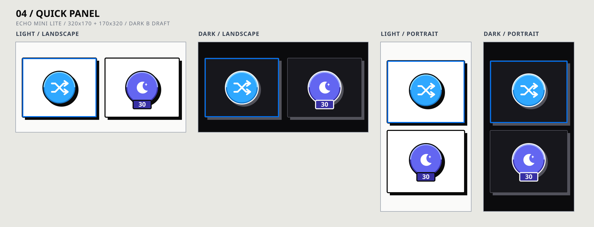

# EchoNeubrutalism

**EchoPod-based firmware for the 512 MB Snowsky (FiiO) Echo Mini, with a personal neo-brutalist Lite UI.**

[中文说明](README.zh-CN.md) · [AI disclosure](AI_DISCLOSURE.md)

> **Personal fork.** Not the official EchoPod project, and not affiliated with FiiO or Snowsky.
> Tested only on the **512 MB** Echo Mini. The **8 GB** model is not supported.

<p align="center">
  
</p>

<p align="center"><em>Home, Now Playing, Settings and Quick panel are design mockups (2×), not device screenshots. The boot sheet below is rendered from the actual firmware assets.</em></p>

## What this is

This is my personal build of [EchoPod](https://github.com/BasilSkyWalk/echopod) for the
**512 MB** Echo Mini. It keeps EchoPod's playback engine and fixes, and replaces the interface
with a compact Lite UI built around the 320×170 screen.

The firmware is **not** a stock replacement for the 8 GB player. Do not flash these images on
an 8 GB unit.

## Tested hardware

| | |
|---|---|
| Device | Snowsky (FiiO) Echo Mini **512 MB** |
| Hardware | 2.2.0 |
| Storage | SD NAND, internal FAT32 user volume |
| Tested | Earlier Lite builds on one 512 MB unit, 2026 |
| Not tested | 8 GB Echo Mini, other hardware revisions |

The dark/portrait build in this branch still needs a final device check.

The stock FiiO updater and the MaskROM recovery path were both exercised during development.
Keep the official firmware and a known recovery path before flashing.

## What I changed

- **512 MB port and Lite build:** `ECHO_LITE=ON`, no covers, Lite menus and layouts.
- **Runtime Light / Dark:** Settings → Display → Theme. Light is the default.
- **Runtime Landscape / Portrait:** Settings → Display → Orientation, 320×170 or 170×320.
- **Lite Home:** three self-drawn colour badges, no text, no page dots.
- **Lite Settings:** one category per screen; long Play switches category.
- **Quick panel:** two icon-only cards for playback mode and sleep timer.
- **Now Playing:** 18 px native mode/state icons, no cover frame.
- **Boot and charging:** static 316×166 landscape boot still and a 166×316 portrait still;
  charging keeps the 96×64 animation card.
- **Controls:** volume single/double/long press in Now Playing; long Play opens the playback
  panel; long Menu opens Settings; long Back in the panel goes Home.
- **Space work:** Lite icon masks moved to a glyph face; Lite theme store/assets removed;
  unused Lite paths dropped.
- **Upstream:** current with EchoPod 0.13.2 when this README was written, including its playback,
  USB, FAT and HE-AAC fixes.

The boot chain, IDB, PMU firmware, fw2 and slot layout are not modified.

## UI previews

> **These are design mockups, not screenshots of the device.** They show the intended layout and
> palette; the real screen may differ in font rendering and final asset placement. The boot sheet
> is rendered from the actual `LBOO` / `LBO2` assets, not a device photo.

| Home | Now Playing |
|---|---|
|  |  |

| Settings | Quick panel |
|---|---|
|  |  |


*Actual boot art (2×), not a device photo: landscape 316×166 and portrait 166×316. Art: Mountain Dusk by ansimuz, CC0 1.0.*

## Build

Requirements: CMake, Python 3, SDL2 for the simulator, and an `arm-none-eabi-gcc` with newlib
headers for the device build.

```sh
cmake --preset release-lite
cmake --build --preset release-lite
```

This writes `build/release-lite/HIFIEC90.IMG`. The normal `release` preset still builds the
upstream-style firmware.

For development:

```sh
cmake --preset dev
cmake --build --preset dev
ctest --preset dev
```

## Install (512 MB only)

The 512 MB updater looks for `/ECHOMINI.IMG` or `/MINIV000.IMG`–`/MINIV999.IMG`; it does **not**
look for `HIFIEC90.IMG`. Copy the image to the card root as, for example, `MINIV919.IMG`, then
install it with the player's updater.

- Keep a copy of the official 512 MB firmware and read `docs/device-install.md` first.
- The 8 GB model is not supported.
- Flashing custom firmware can brick the device or lose data.

## Upstream and credit

This project is based on [EchoPod](https://github.com/BasilSkyWalk/echopod) by BasilSkyWalk and
its contributors. Thank you to the upstream authors for the playback engine, hardware support
and the GPL firmware base.

- EchoPod upstream is **not** responsible for this fork and does not provide support for it.
- Please do not report this fork's bugs or installation problems to the upstream project.
- Hardware research also draws on the [ReChord](https://github.com/brnomt/ReChord) project.
## Art credits

- **Boot stills:** *Mountain Dusk* by [ansimuz](https://ansimuz.itch.io/mountain-dusk-parallax-background),
  CC0 1.0. The landscape still is cropped to 316×166; the portrait still is cropped from the
  320×240 preview to 126×240, resized to 166×316, and quantised to 16 colours.
- **Lite UI icons and badges:** drawn procedurally in this fork; no third-party icon set.
- **Inter font:** SIL Open Font License 1.1.
- **Noto Sans CJK SC glyph packs:** SIL Open Font License 1.1.
- **Other third-party components:** see `third_party/` and `LICENSE`.

## AI disclosure

The custom changes in this fork (the Lite UI, the 512 MB port/glue code, tests and documentation)
were generated with **DeepSeek AI** under human direction. They were not reviewed line by line
by a human. Verification was limited to automated tests and testing on one 512 MB unit; there
was no formal security, licensing or provenance audit, and no 8 GB testing.

The upstream EchoPod code and third-party components remain the work of their original authors
and are covered by their licenses. The maintainer is responsible for publishing this fork, but
gives no warranty and does not claim the code is error-free.

See [AI_DISCLOSURE.md](AI_DISCLOSURE.md) for the full statement.

## Disclaimer

This is an unofficial personal project. It is not affiliated with, endorsed by, or supported by
FiiO, Snowsky, the EchoPod upstream, or their contributors. FiiO and Snowsky trademarks belong
to their owners.

Flashing custom firmware can brick the device, erase data, affect the manufacturer warranty, or
have other consequences. Use it at your own risk. Keep a copy of the official firmware and a
known recovery path. The maintainer accepts no liability for damage, data loss, or other
consequences.

This project is intended for personal, non-commercial use on hardware you own. It is tested only
on the 512 MB Echo Mini; the 8 GB model is not supported. This is not legal advice.

## License

GPL-3.0-or-later. See `LICENSE`. The bundled Inter font is under the SIL Open Font License 1.1,
the Noto CJK glyph packs under the SIL Open Font License 1.1, and the other third-party
components under their own licenses in `third_party/`.

## Upstream sync

This repository uses `origin` for this personal fork and `upstream` for EchoPod:

```sh
git fetch upstream
git merge upstream/main
```
