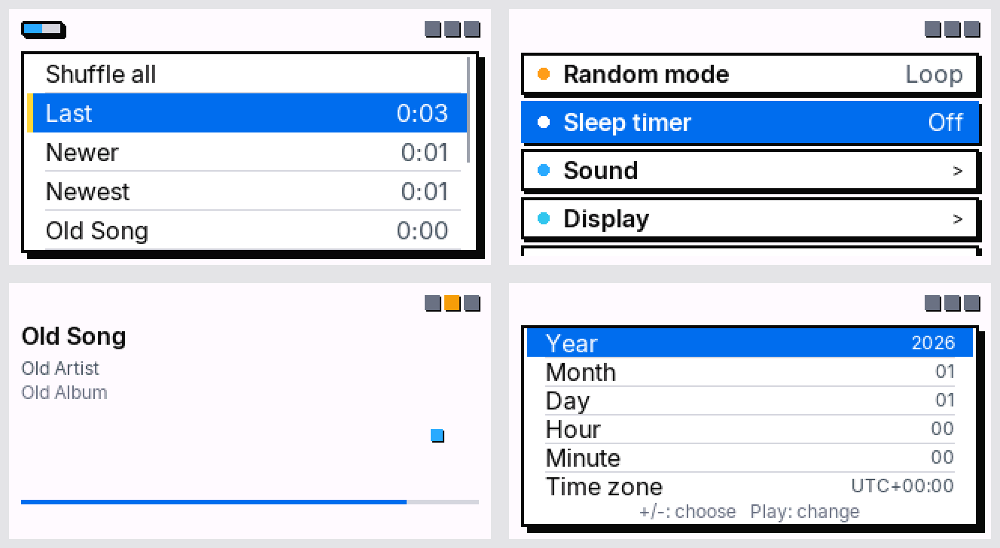
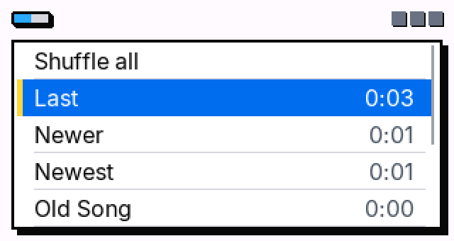
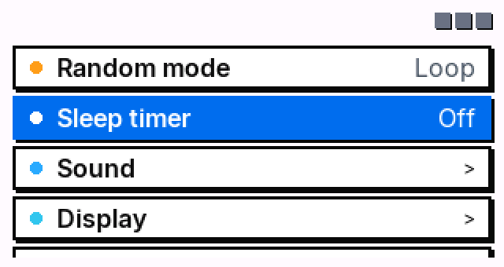
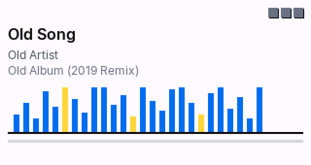
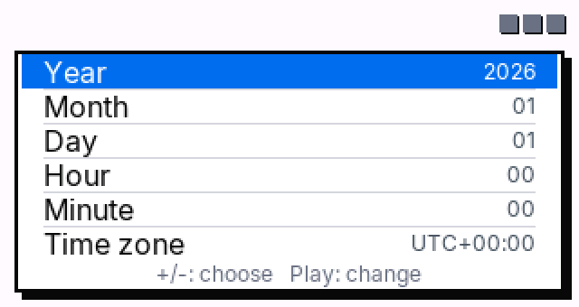
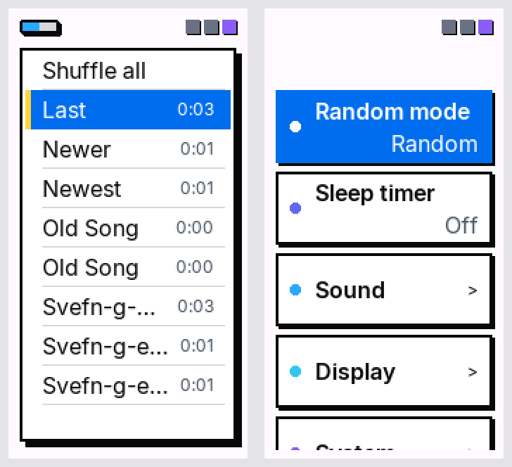
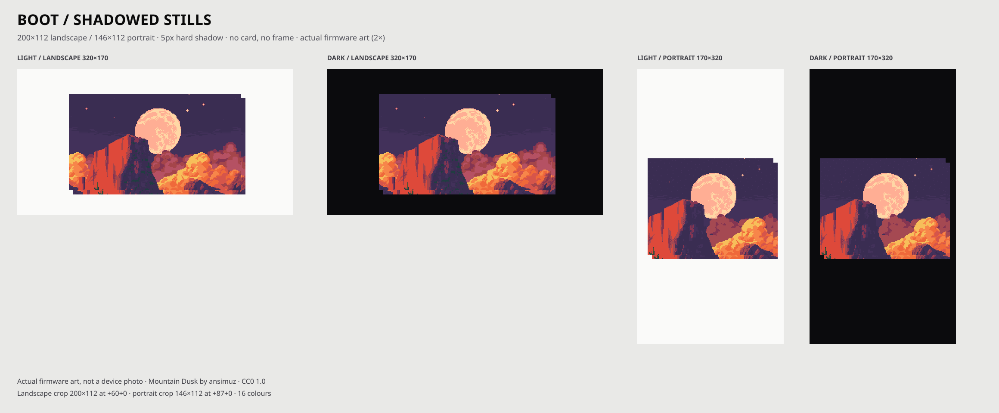

# EchoNeubrutalism

**基于 EchoPod 的 512 MB Snowsky（FiiO）Echo Mini 固件，带个人 neo-brutalist Lite UI。**

[English](README.md) · [文档](docs/README.md) · [AI 声明](AI_DISCLOSURE.md)

> **个人分支。** 不是 EchoPod 官方项目，也不隶属于 FiiO 或 Snowsky。
> 只在 **512 MB** Echo Mini 上测试过；**不支持 8 GB 型号**。

<p align="center">
  
</p>

<p align="center"><em>当前 Lite UI（2×）：All Songs、Settings、Now Playing、Date/Time。模拟器截图；按键说明和注意事项见 <a href="docs/lite/README.md">docs/lite/README.md</a>。</em></p>

## 这是什么

这是我自己维护的 **512 MB** Echo Mini 版 [EchoPod](https://github.com/BasilSkyWalk/echopod)。
保留 EchoPod 的播放引擎和修复，把界面换成为 320×170 / 170×320 设计的 Lite UI。

它不是 8 GB 机型的通用替代固件。不要在 8 GB 机器上刷这些镜像。

**先读：** [Lite 说明与按键表](docs/lite/README.md) ·
[完整按键](docs/lite/shortcuts.md) ·
[安装与恢复](docs/lite/install-512m.md)。

> **个人构建。** 不是 EchoPod 官方项目，也不隶属于 FiiO 或 Snowsky。刷写自定义固件可能导致
> 设备变砖或数据丢失。请保留官方固件和可用的恢复路径。只在一台 512 MB 实机上测试过；
> 不支持 8 GB 型号。

## 测试过的硬件

| | |
|---|---|
| 设备 | Snowsky（FiiO）Echo Mini **512 MB** |
| 硬件版本 | 2.2.0 |
| 存储 | SD NAND，内部 FAT32 用户分区 |
| 测试 | 较早的 Lite 构建在一台 512 MB 实机上测试过，2026 年 |
| 未测试 | 8 GB Echo Mini、其他硬件版本 |

最新的 dark/portrait 构建还需要最后一次实机检查。开发过程中验证过 FiiO 原厂 updater 和
MaskROM 恢复路径。

## 交互与按键

没有 Home，只有两个根页面：**All Songs** 和 **Favorites**。

| 按键 | 行为 |
|---|---|
| 短按 Back | 根页面：切换 All Songs / Favorites。列表：上一层。Settings：返回上一页，或离开到当前根。 |
| 长按 Back | 普通页面打开 Settings；Settings 内返回当前根。 |
| 短按 Menu | 打开 Now Playing；已在 Now Playing 时打开 Up Next。 |
| 长按 Menu | 当前页面功能键：All Songs/Favorites 的 A-Z、A-Z 的下一行、Now Playing 的当前歌曲操作；Up Next/Settings 无动作。 |
| Play | 打开/选择；Settings 改值或进入分类；Date/Time 开始/结束编辑。 |
| Volume | 移动选择；Now Playing 短按调音量、双击切歌、长按 seek。 |

长按 Back 是唯一的 Settings 入口。没有双击 Menu，也没有独立播放面板。
完整按键表和 A-Z 布局见 [docs/lite/shortcuts.md](docs/lite/shortcuts.md)。

## 我改了什么

- **根页面：** All Songs 和 Favorites，移除 Home。短按 Back 切换，短按 Menu 打开 Now Playing，
  长按 Back 打开 Settings。
- **状态栏：** y=8 的 10×10 方块；蓝牙、播放和常驻模式块（随机紫色、循环灰色、单曲循环灰色 `1`）。
  未激活为中性灰；根列表左侧另有 All Songs/Favorites 分段条。
- **Settings：** 五行紧凑首页，橙/靛蓝/蓝/青/紫五种圆点，值靠右；一次显示四行，下一行露出一部分。
  Random/Sleep 直接操作；Sound/Display/System 进入分类页。Date/Time 使用同一张卡片。
- **Favorites：** 路径哈希歌曲列表（最多 256 首），歌名+时长、A-Z、独立队列和 resume；
  歌曲操作里 Add/Remove。
- **Now Playing：** 去掉时间行、进度 thumb 和独立模式图标；平进度条、下移的频谱、临时音量数字，
  顶部和所有页面共用同一状态栏。
- **排序：** GB2312 中文按拼音、日文假名按罗马字，和英文一起按 A-Z 混排。开头的 The 按字面保留，
  “The End of the World”归到 T，不再按 E 排。
- **Review 修复：** Settings 分类记住选中行；Date/Time 跨 Now Playing 保留未保存编辑；
  90/120 分钟睡眠倒计时格式正确；深色列表分隔线跟随主题；竖屏 All Songs 显示九行；
  Settings 子页面从状态栏下方开始。
- **空间清理：** Lite 图标 mask 移到 glyph face；移除 Lite theme store/assets；删掉未使用路径。
  resident tables 余量很小，新增表数据要谨慎。
- **上游：** 写这份说明时已合入 EchoPod 0.13.2，包括播放、USB、FAT 和 HE-AAC 修复。

没有修改启动链、IDB、PMU 固件、fw2 或 slot 布局。

## 界面预览

> 这些是当前固件的模拟器截图（2×），不是实机照片。它们展示实际绘制结果；实机面板颜色可能略有差异。
> 开机图是从真实 `LBOO` / `LBO2` 素材渲染的。

| All Songs | Settings |
|---|---|
|  |  |

| Now Playing | Date/Time |
|---|---|
|  |  |

| 竖屏 | 开机 |
|---|---|
|  |  |

历史设计稿保留在 [docs/lite/mockups/README.md](docs/lite/mockups/README.md)，不是当前截图。

## 构建

需要 CMake、Python 3、模拟器所需的 SDL2，以及带 newlib 头文件的 `arm-none-eabi-gcc`。

```sh
cmake --preset release-lite
cmake --build --preset release-lite
```

输出 `build/release-lite/HIFIEC90.IMG`。普通 `release` preset 仍构建上游风格固件。

开发构建：

```sh
cmake --preset dev
cmake --build --preset dev
ctest --preset dev
```

## 安装（仅 512 MB）

512 MB updater 只扫描 `/ECHOMINI.IMG` 或 `/MINIV000.IMG`–`/MINIV999.IMG`，**不扫描**
`HIFIEC90.IMG`。把镜像复制到卡根目录并改名为例如 `MINIVnnn.IMG`，再用播放器的 updater 安装。

- 先保留一份官方 512 MB 固件，并阅读 [docs/lite/install-512m.md](docs/lite/install-512m.md)。
- 不支持 8 GB 型号。
- 刷写自定义固件可能导致设备变砖或数据丢失。

## 上游与致谢

本项目基于 [EchoPod](https://github.com/BasilSkyWalk/echopod)，作者是 BasilSkyWalk 及其贡献者。
感谢上游提供播放引擎、硬件支持和 GPL 固件基础。

- EchoPod 上游**不负责**这个分支，也不为本分支提供支持。
- 请不要把本分支的 bug 或安装问题报到上游。
- 硬件研究也参考了 [ReChord](https://github.com/brnomt/ReChord) 项目。
## 美术来源

- **开机图：** [ansimuz](https://ansimuz.itch.io/mountain-dusk-parallax-background) 的
  *Mountain Dusk*，CC0 1.0。横版裁成 200×112；竖版裁成 146×112；都量化到 16 色。
- **Lite UI 图标和 badge：** 本分支程序化自绘，没有使用第三方 icon set。
- **Inter 字体：** SIL Open Font License 1.1。
- **Noto Sans CJK SC 字库：** SIL Open Font License 1.1。
- **其他第三方组件：** 见 `third_party/` 和 `LICENSE`。

## AI 声明

本分支的自定义修改（Lite UI、512 MB 移植/胶水代码、测试和文档）由 **DeepSeek AI** 在人工指导下生成。
没有经过逐行人工代码审查；验证只包括自动化测试和一台 512 MB 实机测试。没有做正式的安全、许可证或来源审计，
也没有做 8 GB 测试。

上游 EchoPod 代码和第三方组件仍归原作者所有，并遵循其许可证。维护者负责发布这个分支，但不提供任何保证，
也不声称代码没有错误。

完整说明见 [AI_DISCLOSURE.md](AI_DISCLOSURE.md)。

## 免责声明

本项目是非官方个人项目，与 FiiO、Snowsky、EchoPod 上游及其贡献者没有隶属、授权、赞助或支持关系。
相关商标归其所有者。

刷写自定义固件可能导致设备变砖、数据丢失、影响厂商保修或产生其他后果。请自行承担风险，并保留官方固件、
备份和可用的恢复路径。维护者不对损坏、数据丢失或其他后果承担责任。

本项目仅用于在您拥有的 512 MB Echo Mini 上进行个人、非商业用途；8 GB 型号未测试、不支持。
本声明不构成法律意见。

## 许可证

GPL-3.0-or-later，见 `LICENSE`。Inter 字体、Noto CJK 字库和其他第三方组件分别遵循
`third_party/` 中的许可证。

## 上游同步

本仓库用 `origin` 指向个人分支，用 `upstream` 指向 EchoPod：

```sh
git fetch upstream
git merge upstream/main
```
