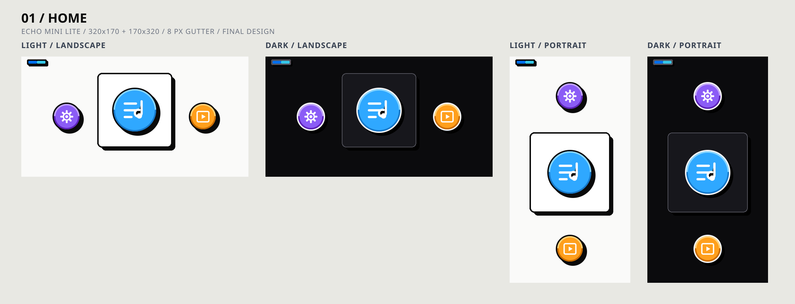
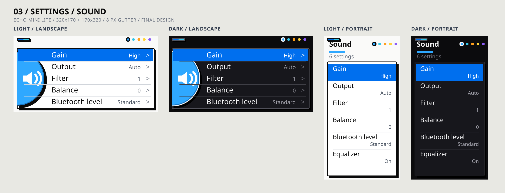
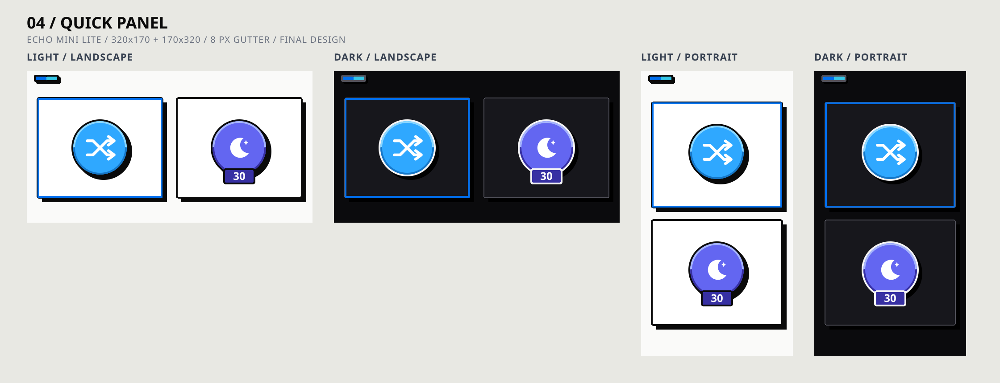

# EchoNeubrutalism

**基于 EchoPod 的 512 MB Snowsky（FiiO）Echo Mini 固件，带个人 neo-brutalist Lite UI。**

[English](README.md) · [文档](docs/README.md) · [AI 声明](AI_DISCLOSURE.md)

> **个人分支。** 不是 EchoPod 官方项目，也不隶属于 FiiO 或 Snowsky。
> 只在 **512 MB** Echo Mini 上测试过；**不支持 8 GB 型号**。

<p align="center">
  
</p>

<p align="center"><em>Home 是 M8 之前的旧设计（现已移除）；Now Playing、Settings 和旧版 Quick panel 是设计稿（2×），不是实机截图；Quick 已拆成 Settings 首页的直接项。下方开机图是从真实固件素材渲染的。</em></p>

## 这是什么

这是我自己维护的 **512 MB** Echo Mini 版 [EchoPod](https://github.com/BasilSkyWalk/echopod)。
保留 EchoPod 的播放引擎和修复，把界面换成为 320×170 小屏设计的 Lite UI。

它不是 8 GB 机型的通用替代固件。不要在 8 GB 机器上刷这些镜像。

## 测试过的硬件

| | |
|---|---|
| 设备 | Snowsky（FiiO）Echo Mini **512 MB** |
| 硬件版本 | 2.2.0 |
| 存储 | SD NAND，内部 FAT32 用户分区 |
| 测试 | 较早的 Lite 构建在一台 512 MB 实机上测试过，2026 年 |
| 未测试 | 8 GB Echo Mini、其他硬件版本 |

本分支的 dark/portrait 构建还需要最后一次实机检查。

开发过程中验证过 FiiO 原厂 updater 和 MaskROM 恢复路径。刷机前请保留官方固件和可用的恢复路径。

## 我改了什么

- **512 MB 移植和 Lite 构建：** `ECHO_LITE=ON`，无封面，Lite 菜单和布局。
- **运行时 Light / Dark：** Settings → Display → Theme；默认 Light。
- **运行时 Landscape / Portrait / Portrait-flipped：** Settings → Display → Orientation，
  320×170 或 170×320（竖屏可翻转 180°）。
- **Lite 根页面：** All Songs 和 Favorites，没有 Home；根层短按 Back 切换两者，短按 Menu 打开 Now Playing，长按 Back 打开 Settings。右上角 10×10 状态方块显示蓝牙和播放；根列表左侧另有 All Songs/Favorites 方块。
- **Lite Settings：** 五张卡片首页——Random mode、Sleep timer、Sound、Display、System。前两项直接操作，后三项进入分类页；类别圆点已移除，横屏保留半圆 icon 和 glyph。睡眠卡片显示实时倒计时。Settings 通过长按 Back 进入。
- **Favorites：** 最多 256 首歌曲，按路径哈希保存；和 All Songs 一样显示歌名+时长并支持 A-Z；作为独立队列播放，重启后恢复；任意歌曲长按 Play 可 Add/Remove Favorites。
- **Now Playing：** 18px 原生播放模式图标，无封面框；蓝牙和播放状态由右上角状态方块表达。音量短按调音量、双击切歌、长按 seek；只保留平进度条作为 seek 反馈，不显示时间行和 thumb。
- **启动和充电：** 开机图为 200×112 横版 / 146×112 竖版图片，带 5px 硬阴影，没有卡片和边框；充电仍用 96×64 动画卡。
- **排序：** GB2312 中文按拼音、日文假名按罗马字，和英文一起按 A-Z 混排；未收录汉字落到 `#`。在可按字母分区的列表里长按 Menu 打开 A-Z/# 跳转。
- **按键：** Now Playing 音量单击/双击/长按；短按 Menu 打开 Now Playing（已在 Now Playing 时打开 Up Next）；长按 Menu 是功能键——All Songs/Favorites 的 A-Z、A-Z 层的下一行、Now Playing 的当前歌曲操作；长按 Back 打开 Settings，在 Settings 内回根。没有双击 Menu，也没有独立播放面板。
- **空间清理：** Lite 图标 mask 移到 glyph face；移除 Lite theme store/assets；删掉未使用的 Lite 路径。
- **上游：** 写这份说明时已合入 EchoPod 0.13.2，包括播放、USB、FAT 和 HE-AAC 修复。

没有修改启动链、IDB、PMU 固件、fw2 或 slot 布局。

## 界面预览

> **这些是设计稿，不是实机截图。** 它们展示预期布局和配色；实机字体渲染和最终素材位置可能略有不同。
> 开机图是从真实 `LBOO` / `LBO2` 素材渲染的，不是设备照片。

状态是 10×10 方块：右侧蓝牙/播放，根列表左侧 All Songs/Favorites；未激活灰色，激活彩色。Now Playing 使用同一行状态方块，只保留一个 18px 播放模式图标；播放状态由黄色方块表达。卡片阴影承担电量/充电颜色。

| Home（旧版） | Now Playing |
|---|---|
|  |  |

| Settings | Quick panel（旧版） |
|---|---|
|  |  |


*真实开机素材渲染（2×），不是设备照片：横版 200×112，竖版 146×112，5px 硬阴影，没有卡片和边框。美术：ansimuz 的 Mountain Dusk，CC0 1.0。*

设计稿图片（PNG）：[docs/lite/mockups/README.md](docs/lite/mockups/README.md)。

## 构建

需要 CMake、Python 3、模拟器所需的 SDL2，以及带 newlib 头文件的 `arm-none-eabi-gcc`。

```sh
cmake --preset release-lite
cmake --build --preset release-lite
```

输出 `build/release-lite/HIFIEC90.IMG`。普通 `release` preset 仍构建上游风格固件。

开发构建：

```sh
cmake --preset dev
cmake --build --preset dev
ctest --preset dev
```

## 安装（仅 512 MB）

512 MB updater 只扫描 `/ECHOMINI.IMG` 或 `/MINIV000.IMG`–`/MINIV999.IMG`，**不扫描**
`HIFIEC90.IMG`。把镜像复制到卡根目录并改名为例如 `MINIVnnn.IMG`，再用播放器的 updater 安装。

- 先保留一份官方 512 MB 固件，并阅读 [docs/lite/install-512m.md](docs/lite/install-512m.md)。
- 不支持 8 GB 型号。
- 刷写自定义固件可能导致设备变砖或数据丢失。

## 上游与致谢

本项目基于 [EchoPod](https://github.com/BasilSkyWalk/echopod)，作者是 BasilSkyWalk 及其贡献者。
感谢上游提供播放引擎、硬件支持和 GPL 固件基础。

- EchoPod 上游**不负责**这个分支，也不为本分支提供支持。
- 请不要把本分支的 bug 或安装问题报到上游。
- 硬件研究也参考了 [ReChord](https://github.com/brnomt/ReChord) 项目。
## 美术来源

- **开机图：** [ansimuz](https://ansimuz.itch.io/mountain-dusk-parallax-background) 的
  *Mountain Dusk*，CC0 1.0。横版裁成 200×112；竖版裁成 146×112；都量化到 16 色。
- **Lite UI 图标和 badge：** 本分支程序化自绘，没有使用第三方 icon set。
- **Inter 字体：** SIL Open Font License 1.1。
- **Noto Sans CJK SC 字库：** SIL Open Font License 1.1。
- **其他第三方组件：** 见 `third_party/` 和 `LICENSE`。

## AI 声明

本分支的自定义修改（Lite UI、512 MB 移植/胶水代码、测试和文档）由 **DeepSeek AI** 在人工指导下生成。
没有经过逐行人工代码审查；验证只包括自动化测试和一台 512 MB 实机测试。没有做正式的安全、许可证或来源审计，
也没有做 8 GB 测试。

上游 EchoPod 代码和第三方组件仍归原作者所有，并遵循其许可证。维护者负责发布这个分支，但不提供任何保证，
也不声称代码没有错误。

完整说明见 [AI_DISCLOSURE.md](AI_DISCLOSURE.md)。

## 免责声明

本项目是非官方个人项目，与 FiiO、Snowsky、EchoPod 上游及其贡献者没有隶属、授权、赞助或支持关系。
相关商标归其所有者。

刷写自定义固件可能导致设备变砖、数据丢失、影响厂商保修或产生其他后果。请自行承担风险，并保留官方固件、
备份和可用的恢复路径。维护者不对损坏、数据丢失或其他后果承担责任。

本项目仅用于在您拥有的 512 MB Echo Mini 上进行个人、非商业用途；8 GB 型号未测试、不支持。
本声明不构成法律意见。

## 许可证

GPL-3.0-or-later，见 `LICENSE`。Inter 字体、Noto CJK 字库和其他第三方组件分别遵循
`third_party/` 中的许可证。

## 上游同步

本仓库用 `origin` 指向个人分支，用 `upstream` 指向 EchoPod：

```sh
git fetch upstream
git merge upstream/main
```
