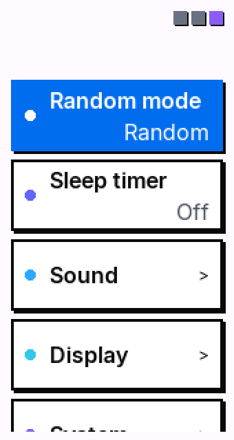

# EchoNeubrutalism Lite

**Personal, experimental firmware for the 512 MB Snowsky (FiiO) Echo Mini.**

> **Read this before flashing.**
>
> This is my own fork, not an official EchoPod or FiiO release. It is tested on one 512 MB
> unit, not on the 8 GB model. Flashing can brick the player, erase the card or lose data.
> Keep the official firmware and a known recovery path, and do not flash it on hardware you
> cannot recover. There is no warranty.


*Current UI in the simulator at 2×: All Songs, Settings, Now Playing and Date/Time. The pixels
come from the firmware itself; colours on a real panel may differ slightly.*

## What this is

This is a personal Lite build of [EchoPod](https://github.com/BasilSkyWalk/echopod) for the
**512 MB** Echo Mini. It keeps EchoPod's playback engine and hardware support and replaces the
front end with a compact neo-brutalist UI for 320×170 and 170×320.

It is not a general replacement firmware. The 8 GB model is not supported.

- **UI:** Lite layout, Light/Dark, landscape/portrait/portrait-flipped.
- **Build:** `release-lite` preset, image size and headroom recorded in
  [install-512m.md](install-512m.md).
- **Upstream:** EchoPod 0.14.0 512 MB support and fixes, plus this fork's Lite changes.
- **Boot chain:** boot chain, IDB, PMU firmware, fw2 and slot layout are not modified.

## Interaction at a glance

There is **no Home screen**. The two roots are **All Songs** and **Favorites**.

```text
Root (All Songs / Favorites)
  ├─ Short Back: switch root
  ├─ Long Back:  Settings
  ├─ Short Menu: Now Playing
  └─ Long Menu:  A-Z jump

Settings
  ├─ Short Back: leave Settings (back to the current root)
  ├─ Long Back:  return to the current root
  └─ Short Menu: Now Playing
```

Inside a list, **Short Back** goes up one level. **Long Back** is always the Settings entry from
a normal screen; inside Settings it returns to the current root. **Short Menu** is navigation
(Now Playing, then Up Next from Now Playing). **Long Menu** is the screen's function key, not a
second navigation key.

### Key map

| Screen | Volume | Play | Menu | Back |
|---|---|---|---|---|
| Root list | move row; hold to scroll faster | short: open | short: Now Playing; long: A-Z | short: switch root; long: Settings |
| Deeper list | move row; hold to scroll faster | short: open; long: song actions on tracks | short: Now Playing; long: A-Z in lettered lists | short: up; long: Settings |
| A-Z / # jump | choose letter | short: jump | short: Now Playing; long: next grid row | short: close; long: Settings |
| Now Playing | short: volume; double: previous/next; long: seek | short: play/pause | short: Up Next; long: current-song actions | short: leave; long: Settings |
| Up Next | move row | short: play | short: Now Playing; long: no action | short: back; long: Settings |
| Settings home | move row | short: change value/open | short: Now Playing; long: no action | short: current root; long: current root |
| Settings category | move row | short: change value/open | short: Now Playing; long: no action | short: Settings home; long: current root |
| Settings subpage | move row | short: change value/open | short: Now Playing; long: no action | short: previous page; long: current root |

Full details and the A-Z grid geometry: [shortcuts.md](shortcuts.md).

### Now Playing

- The time row and progress thumb are removed.
- The progress bar is a flat line; seek is shown by its length.
- Volume short press changes volume, double press skips, long press seeks.
- Bluetooth, playback and the mode block share the top status row.
- There is no separate playback-mode icon on the page.

### Favorites

Favorites is a real track list, not an album shortcut:

- path-hashed, up to 512 songs;
- title + duration, sorted by title, same A-Z/# jump as All Songs;
- selecting a row starts its **own queue**, so next/previous stay in Favorites;
- Long Play removes the selected song;
- the list is cached between root switches and restored through the resume file.

### Settings and Date/Time

Settings opens on five compact rows:

```text
Random mode    Loop
Sleep timer    Off
Sound          >
Display        >
System         >
```

The rows use five distinct dots (orange, indigo, blue, cyan, purple), right-aligned values and
four visible rows with the next peeking. Random/Sleep are direct; Sound/Display/System open
category pages. Date/Time uses the same card, six fields and an in-card hint; the selected row is
blue and the value turns yellow while editing.

## Screens

| All Songs | Settings |
|---|---|
|  |  |

| Now Playing | Date/Time |
|---|---|
|  |  |

| Portrait All Songs | Portrait Settings |
|---|---|
|  |  |

Boot art: [boot-shadow.png](../images/lite/boot-shadow.png). The screenshots are from the simulator,
not device photos; see [design.md](design.md) for tokens and geometry.

## What changed from EchoPod

- **Roots:** All Songs and Favorites; Home removed. Short Back switches roots.
- **Favorites:** song list with its own queue and resume, built through the reusable
  `TrackListScreen`, replacing the old album-only Home shortcut.
- **Settings:** five-row home with colour dots, right-aligned values, four-row scrolling and
  five category pages. Date/Time was moved onto the same card style.
- **Status row:** 10×10 blocks at y=8; Bluetooth, playback, then an always-visible mode block
  (purple random, gray loop, gray `1` loop-one). Inactive states are neutral gray.
- **Now Playing:** no time row or thumb; spectrum/progress moved lower; no separate play/pause
  or mode icon.
- **Sorting:** GB2312 pinyin and kana romaji interleaved with Latin under A-Z. Leading
  articles are literal, so "The End of the World" sorts under T; an existing library needs a
  rescan to pick up the new order.
- **Space work:** the Lite build drops the unused cover cache (about 67 KB of static RAM), so
  song Favorites can hold 512 tracks. Lite app static RAM is 69,586 / 131,072 bytes (61,486
  free); the loaded total has about 95 KB free. Lite icon masks
  moved to the glyph face; Lite theme-store/assets removed. Resident tables still have only
  196 bytes free, so keep new table data small.
- **Review fixes:** Settings categories remember their row; Date/Time preserves an unsaved edit
  across the Now Playing overlay; 90/120-minute sleep countdown formats correctly; dark-mode row
  separators follow the theme; portrait All Songs shows nine rows; list subpages stay below the
  status row.

Detailed diff: [customizations.md](customizations.md). Design: [design.md](design.md).

## Build

```sh
cmake --preset release-lite
cmake --build --preset release-lite
```

Output: `build/release-lite/HIFIEC90.IMG`.

Host checks:

```sh
cmake --preset dev
cmake --build --preset dev
ctest --preset dev -E '^format$'
```

Lite UI tests: `build/lite-test/tests/test_lite_panel`. The full Lite test configuration is not
yet a separate CTest target; treat `test_lite_panel` as the authoritative UI suite.

The Lite app static RAM audit uses the real `release-lite` compile commands:

```sh
python3 tools/lite_ram_audit.py \
  --compile-commands build/release-lite/compile_commands.json \
  --budget-bytes 131072
```

Current result: **69,586 / 131,072 bytes (61,486 free)**. The older `target_audit` compiles the
non-Lite source set, so it is not a substitute for this Lite-specific number.

## Install and recovery

See [install-512m.md](install-512m.md). The 512 MB updater looks for `/ECHOMINI.IMG` or
`/MINIV000.IMG`–`/MINIV999.IMG`, not `HIFIEC90.IMG`. Copy the image to the card with a supported
name, run the updater, and keep the official firmware available.

## Scope and caution

- **512 MB only.** The 8 GB model is not supported.
- **Personal project.** Not affiliated with or supported by FiiO, Snowsky or EchoPod upstream.
- **No signature check is assumed.** Flashing modified firmware is at your own risk.
- **One device tested.** The final device pass is still pending for the newest build.
- **AI-assisted.** The Lite changes, tests and docs were generated with AI under human direction;
  see [AI_DISCLOSURE.md](../../AI_DISCLOSURE.md).
- **Not changed:** boot chain, IDB, PMU firmware, fw2 and slot layout.
