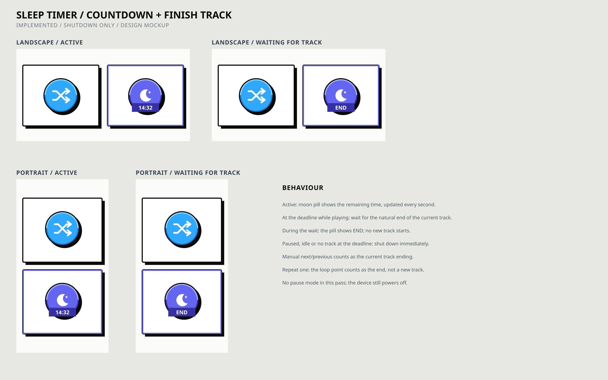

# Lite design

The final Lite design is a neo-brutalist interface with runtime Light/Dark and landscape/portrait.
The mockup sheet is [mockups/index.html](mockups/index.html).

> The Home, Now Playing, Settings and Quick panel images are design mockups, not device screenshots.
> The boot image is rendered from the actual firmware assets.

## Palette

| Token | Light | Dark |
|---|---|---|
| page | `#FAFAF9` | `#0B0B0D` |
| card | `#FFFFFF` | `#17171C` |
| raised / frame | `#FFFFFF` | `#1F1F26` |
| primary text | `#0A0A0A` | `#F4F4F5` |
| secondary text | `#4B5563` | `#A1A1AA` |
| tertiary text | `#6B7280` | `#71717A` |
| card border / title rule | `#0A0A0A`, 2 px | `#52525B`, 1 px |
| badge border | `#0A0A0A`, 2 px | `#F4F4F5`, 2 px |
| divider / track | `#D1D5DB` | `#3F3F46` |
| card and badge shadow | `#0A0A0A` | `#000000` |
| selection | `#006FEE` | `#006FEE` |

Badge colours: blue `#2FA8FF`, orange `#FF9F1C`, purple `#8B5CF6`, indigo `#6366F1`,
cyan `#35C7E8`, amber `#F59E0B`, success `#22C55E`.

## Spacing

- Base unit: 4 px. Outer gutter: 8 px left/right/bottom on panel screens
  (Settings, Lists, Now Playing).
- Landscape header band: 28 px. The status meter is 28×8 at `(8, 4)`; its 2 px
  border/shadow are included in the header, not the content gutter.
- Portrait headers stay editorial: Settings card starts at y=58, Lists at y=40.
  Their cards end 8 px above the bottom edge.
- Now Playing uses 8 px top/sides/bottom. Content width is 304 px landscape and
  154 px portrait; the time row ends 8 px above the bottom edge.
- Quick panel is an intentional two-card exception: 12 px horizontal gutter and
  30/35 px vertical margins.
- Home is a centred composition; it has no outer panel gutter.

## Layout

### Home

- Landscape: 104×104 card at (108, 24), 6 px radius, 64 px selected icon, 40 px side icons.
- Portrait: 112×112 card at (29, 108), 6 px radius, 64 px selected icon, 40 px side icons above/below; 32 px gaps to the card.
- No text, no page dots. No playback bars; playback lives in the global status meter.

### Home status

- Top-left 28×8 status meter at (8, 4): 2 px border, 2 px hard shadow, two 12×4 cells.
  Left cell blue `#006FEE` when Bluetooth is connected; right cell cyan `#35C7E8` when
  playing. Inactive cells use the divider colour.
- Light border is ink; dark border is `#52525B`; the shadow is black in both themes.
- Now Playing replaces the meter with a 14×8 Bluetooth-only chip beside the shuffle/play
  icons (x=236/96, y=13); the play/pause icon already shows playback.
- The card shadow carries the battery/charging colour; the status meter does not.

### Now Playing

- Landscape: title at (8, 8), Bluetooth chip at x=243, state icons at x=269/294,
  spectrum 304×70, progress at y=138, times at y=144.
- Portrait: Bluetooth chip at x=93, state icons at x=119/144, title at (8, 24), spectrum
  154×194 at y=86, progress at y=288, times at y=294. The time row ends 8 px above the bottom.

### Sorting

- GB2312 Chinese sorts by primary pinyin and kana by romaji, interleaved with Latin under
  A-Z. Unknown Hanzi/kanji keep their code point and fall under the final `#`.
- The asset is `assets/pinyin.bin`; sorting uses the rescan scratch, not daily RAM. The
  selected row's section is read from the image on demand.
- Double Menu in a lettered list opens the A-Z/# jump overlay; volume selects, Play jumps.
  Volume hold only scrolls rows.

### Now Playing seek feedback

Seek uses the progress and time display; there is no separate hold gauge. A 28×8 hold gauge
was prototyped and deferred because it duplicated that feedback and hid the Bluetooth chip.

### Settings

- Landscape: no text header; the half-badge, category dots and rows carry the category. The
  status meter is at (8, 4) and the category dots centre on y=8; the card stays at y=28;
  five 26 px rows.
- Portrait: no large icon; category title, colour rule, two-line rows.
  Sound 6×38 px, System 7×34 px in a 154×254 card at (8, 58). The card ends 8 px above
  the bottom edge. The category title stays because portrait has no half-badge.

### Quick panel

- Landscape: two 140×112 cards side by side.
- Portrait: two 146×118 cards stacked at y=35/167.

### Sleep timer

The sleep timer remains a **shutdown** timer; this pass does not add a pause mode. Implemented.

- Panel: the moon pill shows the remaining time (`14:32`, `0:45`), updated every second; when
  the deadline passes while a track is playing, it shows `END` while waiting for that track.
- At the deadline, playing with a track: wait for the natural end of the current track, then
  power off. Do not start the next track audibly.
- Paused, idle, or no track at the deadline: power off immediately.
- Manual next/previous counts as the current track ending; repeat-one's loop point counts as
  the end. Seeking within the track does not.
- Pausing during the `END` wait powers off immediately.
- The timer lives in RAM; a restart or power loss cancels it. There is no RTC alarm.

### Lists

- Landscape: five rows.
- Portrait: nine rows of 28 px in a 154×272 card at (8, 40); the card ends 8 px above the
  bottom edge.

### Boot / charge

- Boot landscape: 200×112 still at (60, 29) with a 5 px hard shadow; no card panel, no frame.
- Boot portrait: 146×112 still at (12, 104) with a 5 px hard shadow; no card panel, no frame.
- Charge: 200×112 landscape card, 146×112 portrait card, 96×64 animation inside.
- Boot art: Mountain Dusk by ansimuz, CC0 1.0.

## Selection and status

- Selection is flat blue `#006FEE` with white text.
- Normal dark card shadow is `#000000`; the dark border stays `#52525B`.
- Low battery / charging status colours override the card shadow: yellow ≤20%, purple ≤10%,
  red ≤5%, green when charging.
- Dark mode keeps light borders only on badges; large surfaces use 1 px grey borders to avoid
  a wall of white lines at night.
