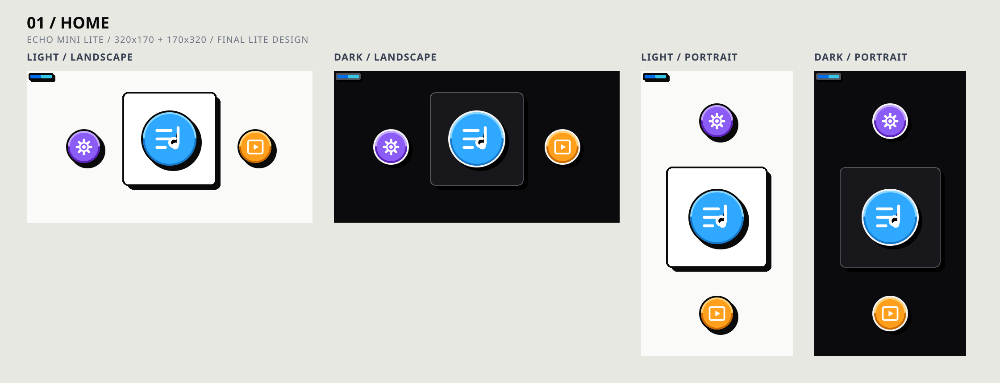
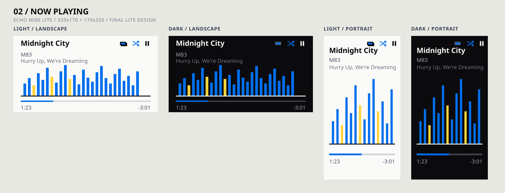
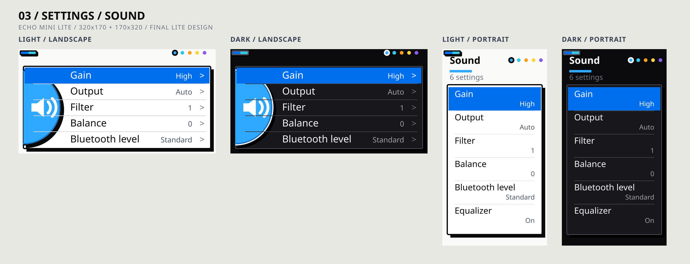
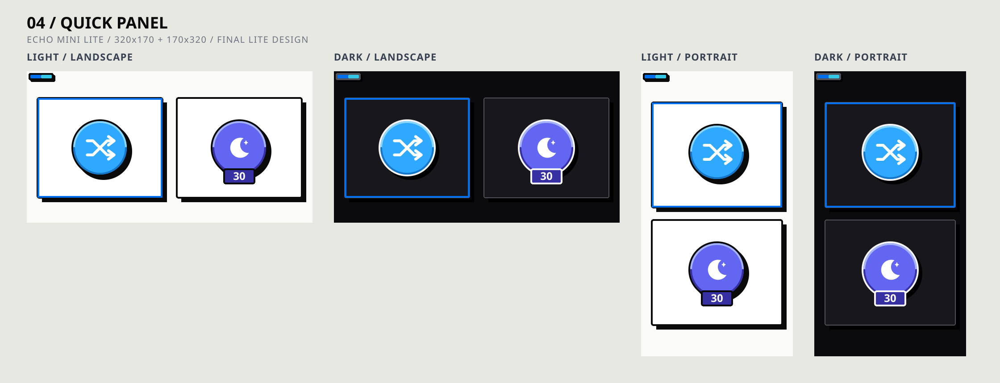
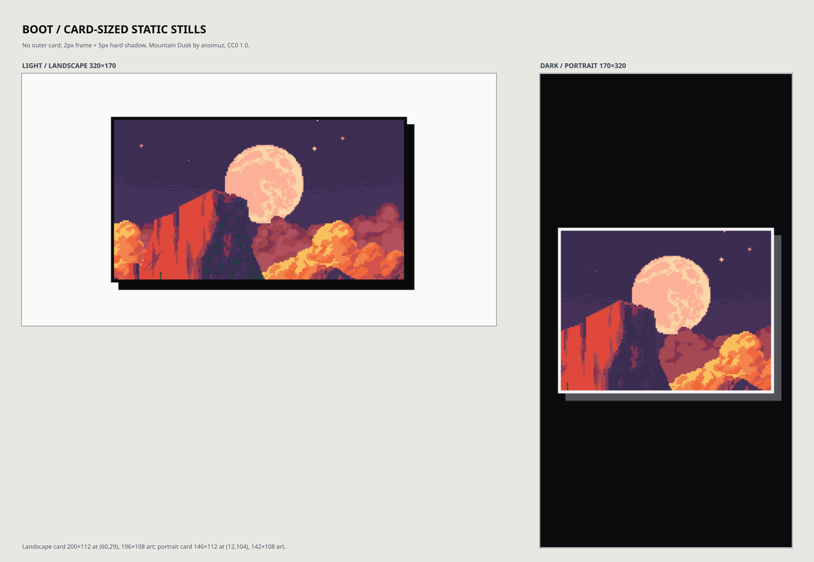

# Final Lite mockups

These are the final design-reference sheets for the 512 MB Lite UI. The Home, Now Playing,
Settings and Quick panel sheets are **design mockups, not device screenshots**; real font
rendering and final asset placement can differ slightly. The boot sheet is rendered from the
actual `LBOO` / `LBO2` firmware assets.

The PNG files below are the design source. The HTML page is only a convenience index; it is not
a screenshot source.

## Final design rules

- Home card: 6 px radius, 104×104 landscape / 112×112 portrait, 64 px selected icon, no keyline.
- Status: 28×8 meter at top-left (blue = Bluetooth, cyan = playing). Now Playing uses a
  14×8 Bluetooth-only chip beside shuffle/play.
- Settings: landscape has no text header; the status meter and category dots share the top band.
  Portrait keeps the category name.
- Battery/charging: still carried by the card shadow.
- Dark: border `#52525B`, shadow `#000000`.

## Home



## Now Playing



## Settings



## Quick panel



## Boot stills



## Dark palette

```text
page       #0B0B0D
card       #17171C
text       #F4F4F5
muted      #A1A1AA
border     #52525B
shadow     #000000
selection  #006FEE
blue       #2FA8FF
orange     #FF9F1C
purple     #8B5CF6
indigo     #6366F1
```

The optional HTML index is [index.html](index.html). The implementation-level layout spec is
[../design.md](../design.md).
