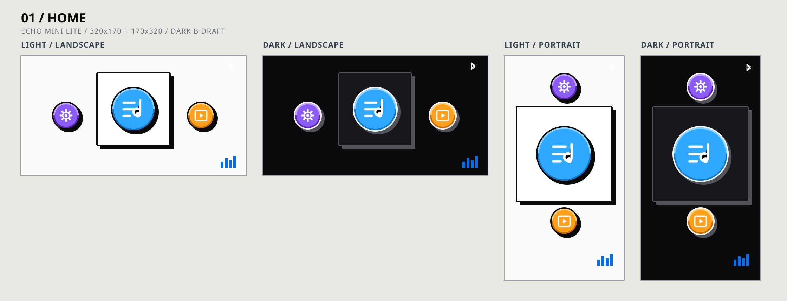
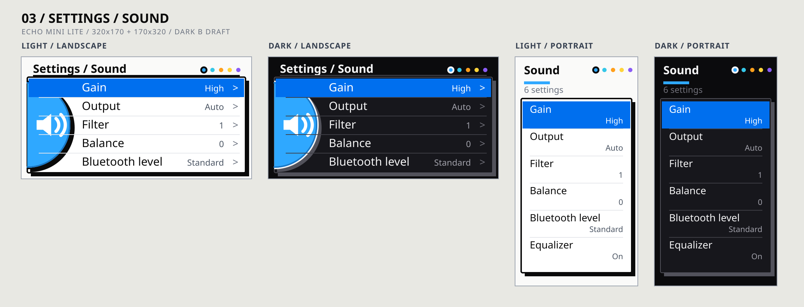
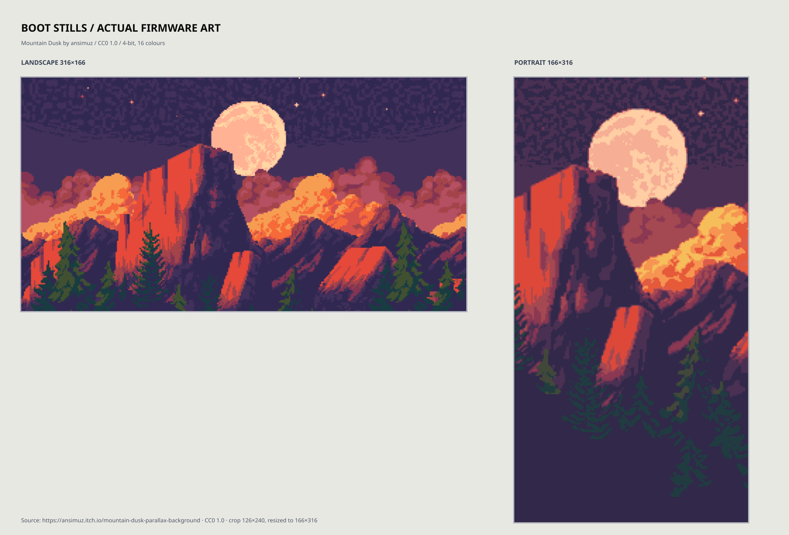

# Final Lite mockups

These are the final design-reference sheets for the 512 MB Lite UI. The Home, Now Playing,
Settings and Quick panel sheets are **design mockups, not device screenshots**; real font
rendering and final asset placement can differ slightly. The boot sheet is rendered from the
actual `LBOO` / `LBO2` firmware assets.

## Home



## Now Playing


## Settings



## Quick panel


## Boot stills



## Dark palette

```text
page       #0B0B0D
card       #17171C
text       #F4F4F5
muted      #A1A1AA
border     #52525B
selection  #006FEE
blue       #2FA8FF
orange     #FF9F1C
purple     #8B5CF6
indigo     #6366F1
```

The HTML version is [index.html](index.html). The implementation-level layout spec is
[../design.md](../design.md).
