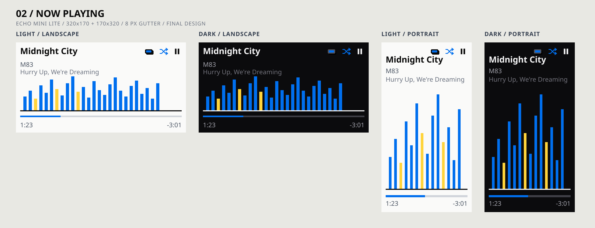
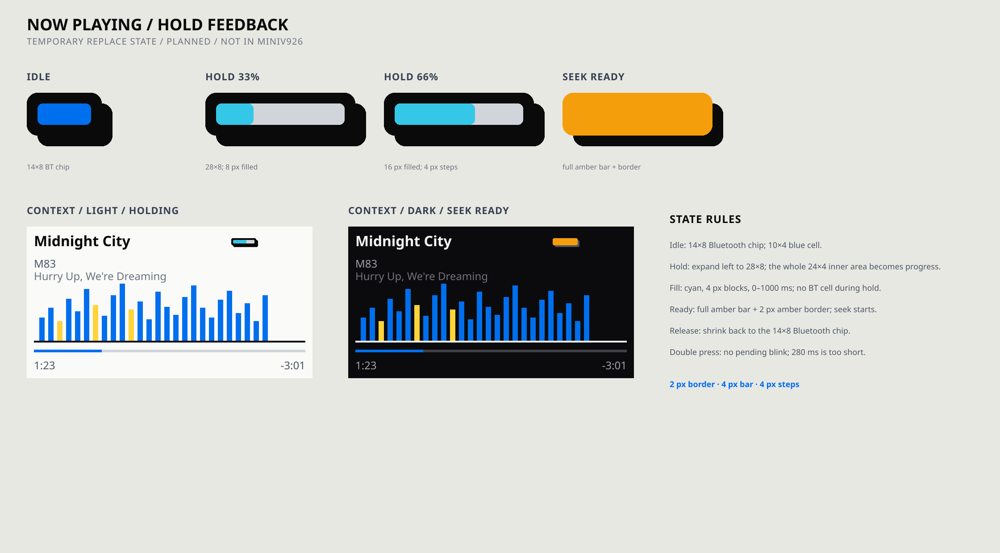

# Final Lite mockups

These are the final design-reference sheets for the 512 MB Lite UI. The Home, Now Playing,
Settings and Quick panel sheets are **design mockups, not device screenshots**; real font
rendering and final asset placement can differ slightly. The boot sheet is rendered from the
actual `LBOO` / `LBO2` firmware assets.

The PNG files below are the design source. The HTML page is only a convenience index; it is not
a screenshot source.

## Final design rules

- Spacing: 4 px base; 8 px outer gutter on panel screens; 28 px landscape header.
- Home card: 6 px radius, 104×104 landscape / 112×112 portrait, 64 px selected icon, no keyline.
- Status: 28×8 meter at `(8, 4)` (blue = Bluetooth, cyan = playing). Now Playing uses a
  14×8 Bluetooth-only chip beside shuffle/play.
- Settings: landscape has no text header; the meter is at `(8, 4)` and the category dots centre
  on y=8. Portrait keeps the category name and ends its card 8 px above the bottom.
- Now Playing: 8 px sides/top/bottom; content width 304/154; times end 8 px above the bottom.
- Lists portrait: 154×272 card ending 8 px above the bottom.
- Quick panel: intentional 12 px horizontal / 30–35 px vertical exception.
- Battery/charging: still carried by the card shadow.
- Dark: border `#52525B`, shadow `#000000`.

## Home


## Now Playing



## Now Playing hold feedback (planned)

This is a design target, **not in MINIV926**. A volume long-press temporarily replaces the
14×8 Bluetooth chip with a 28×8 progress bar; at 1000 ms it turns amber and seek begins.

Scope: volume long-press seek only; not a general long-press gauge. Play/Menu/Back and Power
are out of scope for now.



## Settings


## Quick panel


## Boot stills


## Dark palette

```text
page       #0B0B0D
card       #17171C
text       #F4F4F5
muted      #A1A1AA
border     #52525B
shadow     #000000
selection  #006FEE
blue       #2FA8FF
orange     #FF9F1C
purple     #8B5CF6
indigo     #6366F1
```

The optional HTML index is [index.html](index.html). The implementation-level layout spec is
[../design.md](../design.md).
